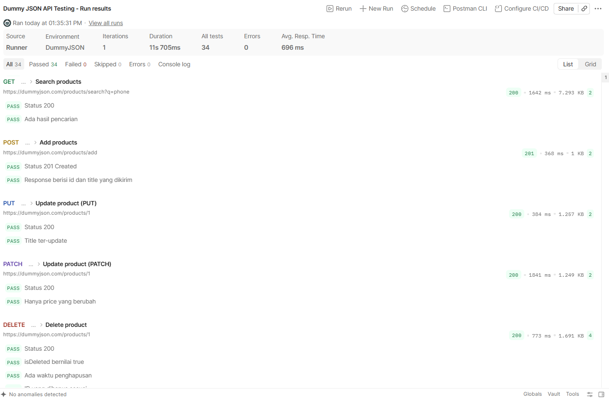

# QA Portfolio: API & SQL Testing

Proyek latihan pengujian API menggunakan Postman terhadap API publik DummyJSON.

## Tujuan
Menunjukkan kemampuan menguji endpoint API: autentikasi, CRUD, negative testing, serta validasi status code dan response.

## Tools
- Postman (Collection, Environment, Collection Runner)
- DummyJSON (https://dummyjson.com)

## Cakupan Pengujian

**Auth**
- Get profile tanpa token (negative test, 401)
- Login dengan kredensial valid
- Login dengan password salah (negative test, 400)
- Get profile dengan token

**Products**
- Get all products
- Get product by ID (valid)
- Get products dengan limit
- Search products
- Add product (POST)
- Update product (PUT)
- Update product (PATCH)
- Delete product
- Get product invalid (negative test)
- Add product tanpa body (negative test)

Total 14 request dengan 34 test. Setiap request divalidasi untuk status code, isi response, dan beberapa juga waktu respons.

## Hasil
34 dari 34 test lulus di Collection Runner.

## Cara Menjalankan
1. Import `Dummy JSON API Testing.postman_collection.json` dan `DummyJSON.postman_environment.json` dari folder `api-testing` ke Postman.
2. Pilih environment DummyJSON.
3. Jalankan collection lewat Collection Runner.

## Rencana Berikutnya
- Folder SQL: query validasi data (duplikat, NULL, data yatim/orphan)
